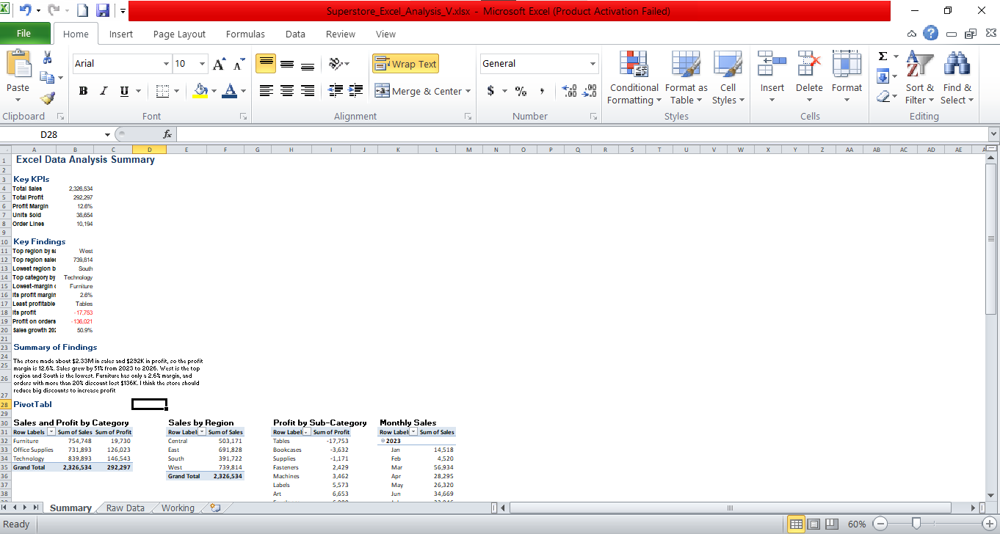

# Excel Data Analysis: Superstore Sales

## Overview
Analysed the Sample Superstore dataset (orders 2023-2026) using
core Excel tools to answer basic business questions.

## Workbook Structure
- Raw Data: original orders data, untouched
- Working: SUMIFS, COUNTIFS and AVERAGEIFS formulas using named ranges
- Summary: KPIs, 4 PivotTables and a short summary of findings

## PivotTables
1. Sales and Profit by Category
2. Sales by Region
3. Profit by Sub-Category
4. Monthly Sales trend

## Key Findings
- Sales: about $2.33M, profit: $292K, margin: 12.6%
- Sales grew 51% from 2023 to 2026
- Furniture has only a 2.6% margin
- Orders with more than 20% discount lost $136K

## Tools Used
Microsoft Excel

## Dataset
Sample Superstore Dataset

## Screenshot

